# Kobox

**One voice from two engines.** Kokoro speaks instantly. Chatterbox performs the laughs, sighs, gasps and moods for real. Whisper checks every performed line before you hear it. Kobox makes the three sound like one person.

[](https://github.com/go-chiranjeet/kobox/actions/workflows/tests.yml)  


Kobox was built for **REHA**, a local, private AI assistant, to fix a problem every expressive voice runs into:

- **Fast** speech models (like Kokoro) start talking in a fraction of a second, but read `[laughs]` as a flat word, or skip it.
- **Expressive** models (like Chatterbox) really laugh and sigh, but take seconds per line and sound like a different, quieter person.
- **Switching** between the two gives you gaps, jumps in loudness and the occasional garbled word.

Kobox gives you both, without the seams.

---

## How it works

### 1. Plan, then render in parallel
The reply is split into lines.
- **Plain lines** go to Kokoro (about 0.2 s each), so she starts speaking at once.
- **Lines with a cue** (`[laughs]`, `[sighs]`, `Aww…`, `[sarcastically]`…) go to Chatterbox, which renders them *while she is already talking*.
- Long expressive sentences are trimmed to just the clause the laugh belongs to, so renders stay short.


### 2. Make two engines sound like one voice
Out of the box, Chatterbox's lines are 7-9 dB quieter, brighter and start late. Before a line plays, Kobox:
1. trims the lead silence;
2. pulls the tone toward Kokoro;
3. matches the speech level;
4. applies a speaker-safe limit.

Everything then plays through **one continuous output stream**, with 20 ms equal-power crossfades.


### 3. Check before you hear it
Whisper (large-v3-turbo, local) listens to every performed line. If the word error rate is above 0.25, or any number or name is wrong ("fifteen" heard as "fifty"), the take is re-rendered once. If it still fails, it is never played.

### 4. Never silent, never fake
Every expression has a way out:
- **The live performance plays**, when it's ready and checked.
- **Or a real take from her expression bank plays**, followed by Kokoro saying the words.
- **Or Kokoro speaks the line**, and the cue becomes a short beat.

A cue is never read aloud, and Kokoro never fakes a laugh.



### 5. An expression bank that learns
Short sounds are rendered ahead of time, checked, and kept as several takes each: laughs, chuckles, sighs, gasps, groans, sniffs, "ahem", "shh", "mm-hmm", "aww", "ooh", "ugh", "whoa", "yay", "phew", "oops", "uh-oh".
- They play **instantly**, never the same take twice in a row.
- Feedback reshapes the bank: 👍 makes a take more likely, 👎 retires it, and Less / More changes how often she expresses herself. In REHA these are buttons under each spoken reply. As a library, call `v.kobox.bank.feedback(v.kobox.last["takes"], +0.3)` (or `-0.6`) and `bank.set_expressiveness(±1)` from your own UI.
- A fresh take of every sound is rendered each week.

She can also **learn expressions from someone else's recording**:
1. The recording is cut into moments.
2. Sung notes (a held musical pitch) and anything with words are rejected.
3. The rest is re-voiced into *her* voice with Chatterbox's voice converter.
4. Whisper confirms each one is a pure expression.

Her speaking voice never changes, and the original audio isn't kept.


---

## Hear it

All clips are REHA's voice, rendered on a MacBook Pro (M4 Pro), recorded straight from Kobox's output stream.

| Clip | Listen for |
|---|---|
| [opens-with-a-laugh](docs/demos/opens-with-a-laugh.m4a) | a real laugh from the bank, instantly, then Kokoro carries on in the same voice |
| [opens-with-a-hum](docs/demos/opens-with-a-hum.m4a) | "Mm-hmm" performed, not read out |
| [aww](docs/demos/aww.m4a) · [gasp](docs/demos/gasp.m4a) · [groan](docs/demos/groan.m4a) | interjections and sounds in the middle of ordinary speech |
| [sarcastic-and-mm-hmm](docs/demos/sarcastic-and-mm-hmm.m4a) | a delivery style (sarcastic) and a hum in one reply |
| [long-laughing-sentence](docs/demos/long-laughing-sentence.m4a) | Chatterbox performs only the laughing clause; Kokoro finishes the sentence |
| [palette: surprised](docs/demos/palette-surprised.m4a) · [sarcastic](docs/demos/palette-sarcastic.m4a) · [fear](docs/demos/palette-fear.m4a) · [crying](docs/demos/palette-crying.m4a) · [whispering](docs/demos/palette-whispering.m4a) · [aww](docs/demos/palette-interjection_aww.m4a) · [yay](docs/demos/palette-interjection_yay.m4a) | the wider range Chatterbox Turbo can perform |

## Measured

On an M4 Pro with 24 GB, all local:

| | |
|---|---|
| First sound, warm | **0.0-0.3 s** |
| Expressions performed for real (test set) | **9 of 9**, some from the bank |
| Longest pause inside a reply | 0.4-1.5 s |
| Chatterbox render, one expressive line | about 1-3 s, overlapped with speech |
| Whisper accuracy check | about 0.5 s per line |
| Peak memory, all three models loaded | about 4.5 GB |

## Expressions

Write cues in square brackets before the words they shape. Interjections are written as plain words.

| Kind | Cues |
|---|---|
| Sounds | `[laughs]` `[chuckles]` `[sighs]` `[gasps]` `[groans]` `[sniffs]` `[clears throat]` `[shh]` `[hmm]` `[pause]` |
| Delivery | `[happy]` `[surprised]` `[sarcastically]` `[dramatic]` `[whispers]` `[nervously]` `[annoyed]` `[tearfully]` (plus Kokoro-only `[softly]` `[warmly]` `[playfully]` `[seriously]`…) |
| Interjections | Ooh, Aww, Ugh, Whoa, Pfft, Heh, Uh-oh, Yay, Oops, Phew, Mm-hmm |

## Quick start

macOS on Apple Silicon is the tested setup. You need Python 3.12 for Kobox and Python 3.11 for the Chatterbox environment.

```bash
git clone https://github.com/go-chiranjeet/kobox && cd kobox
./scripts/setup.sh                       # two environments + ~700 MB of models
.venv/bin/python -m kobox doctor
.venv/bin/python -m kobox fill-bank      # first run: renders the expression bank (~2 min)
.venv/bin/python -m kobox say "Okay. [laughs] You actually did it. The rest can wait."
.venv/bin/python -m kobox learn someone-laughing.wav   # only recordings you have the right to use
```

From code:

```python
import asyncio
from kobox.speech import Voice
from kobox.hearing import Ears

v = Voice({"engine": "kobox", "voice": "hf_beta:0.6+af_heart:0.4", "speed": 1.0, "warmth": 0.25})
v.kobox.ears = Ears({"model_file": "ggml-large-v3-turbo-q5_0.bin"})

async def main():
    await v.warm()
    await v.speak("Aww. [happy] That's lovely news!", mood="warm")
    print(v.kobox.label())   # e.g. "Kobox · 2 of 2 expressions performed · started 0.2 s"
asyncio.run(main())
```

Settings (`voice["kobox"]`): `expression_wait_s`, `start_wait_s`, `bank_wait_s`, `wer_max`, `retries`, `crossfade_ms`, `eq_strength`, `mood_lines` and more. See `DEFAULTS` in [`kobox/engine.py`](kobox/engine.py). Everything Kobox stores lives in `~/.kobox` (`KOBOX_HOME`).

## Responsible use

- Every line Chatterbox renders carries Resemble AI's **Perth** watermark.
- Only teach Kobox from recordings you have the right to use. Never use it to imitate a real person without their consent.

## About this repo

This repository is **exported automatically** from the private app Kobox runs in. Each change there is scrubbed, scanned for anything private, tested, and then published here. Issues and pull requests are welcome; accepted changes are applied upstream and come back through the next sync.

Models, libraries and ideas Kobox builds on are listed in **[CREDITS.md](CREDITS.md)**. Licence: [MIT](LICENSE).
